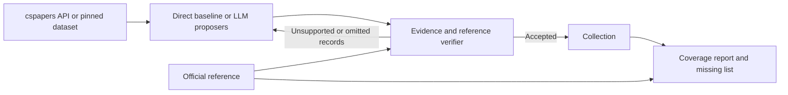

# PurSec paper-scraping agent

## Current results and verification — October 22, 2026

**The scraping prototype is working. Human validation is the next step.**

| Measurement | Current result |
|---|---:|
| cspapers source records | 430 |
| Unique title records / duplicates removed | 420 / 10 |
| Matches against the extracted official research-paper list | 416 / 417 (99.76%) |
| Unmatched collected titles / unmatched reference titles | 4 / 1 |
| Downloaded, readable, title-matched PDFs | 3 |
| Prepared audit | 30 random matches + 4 unmatched + 3 PDF examples |
| Human-measured accuracy | Not measured yet |

**99.76% is reference coverage, not accuracy.** The official reference still needs human scope/completeness review. Author, abstract, and PDF retrieval was limited to three records as a smoke test.

### Where your data is

Everything is saved locally in `runs/usenix-2024-validated/`:

- **`papers.json`**: the 420 deduplicated records, source links, and collected metadata.
- **`papers.csv`**: the same collection in a spreadsheet-friendly format.
- **`pdfs/`**: the three PDFs. Each record's `pdf_path` identifies its file.
- **`report.md`**: counts and coverage; `requests.json` records source provenance.

From this project's terminal:

```bash
open runs/usenix-2024-validated/papers.csv
open runs/usenix-2024-validated/pdfs
```

These run files are local and Git-ignored; cloning GitHub will not retrieve them. The committed [meeting report](docs/meeting-validation.md) and [measurement snapshot](docs/validation-summary.json) summarize this run for the team. The Quick start below explains how to collect a fresh dataset.

### LLM pre-review → your human review

A local `llama3.2:latest` pre-review checks the 37 selected records against saved evidence. **17 of 37 responses failed evidence checks; this model must not approve records.** It does not browse independently or certify correctness. See the [meeting report](docs/meeting-validation.md) for actual outcomes and the rejected first pass.

1. Open `runs/usenix-2024-review/human-review.json` in VS Code. Compare each record against its official links; check the three PDFs directly. Fill in decisions, your name, date, and notes.
2. Review `runs/usenix-2024-review/reference-review.json` against the complete official conference list.
3. Run the command below to calculate audit counts and, once the random sample is fully decided, its membership-accuracy estimate and confidence interval.

```bash
source .venv/bin/activate
python -m pursec_scraper.review summarize
```

Read [the human-verification guide](docs/human-verification.md) for exact field definitions and an editing example. Results appear in `runs/usenix-2024-review/summary.json`. Model judgments stay in `llm-review.json`, separate from your worksheet; read them after your first pass to reduce bias.

**Next:** complete this pilot audit, resolve mismatches, validate a held-out conference-year, then expand collection before extracting statistical methods. This week's deliverable is the working collector plus a reproducible evaluation process.

---

Collect papers from **cspapers.org**, cross-check them against a conference reference, and report what is missing. Runs in Python from this VS Code project.

## Quick start

Python 3.10+ is required. Metadata collection uses only the standard library. PDF inspection additionally requires `pypdf`.

```bash
python3 -m venv .venv
source .venv/bin/activate
pip install -e .

python -m pursec_scraper \
  --venue usenix --year 2024 \
  --source repository --official-usenix \
  --output runs/usenix-2024
```

This collects the **whole conference-year title set**, not a keyword sample. Each run needs a new output directory. HTTP responses are cached between runs; use a new `--cache` directory for a fresh network measurement.

To retrieve abstracts, author metadata, and matching PDFs:

```bash
python -m pursec_scraper \
  --venue usenix --year 2024 \
  --source repository --official-usenix \
  --abstracts --enrich --download-pdfs \
  --output runs/usenix-2024-full
```

For a small download smoke test, add `--limit-enrichment 3`. Discovery and coverage still cover the full year, but author/PDF/abstract retrieval is limited; do not interpret those fields as fully collected.

## What cspapers.org actually provides

The site's [public documentation](https://github.com/swkim101/cspapers.org) says it indexes **titles and abstracts, not authors or paper contents**. We therefore do not invent those missing fields.

- `--source api`: use the same public API as the website, exhausting pagination and checking reported totals.
- `--source repository`: use the site's own public dataset. Pin a Git commit and traverse Git trees rather than the file-list API, avoiding its 1,000-file limit.
- `--source auto` (default): try the API, then fall back to the repository if it fails or returns inconsistent pagination. Record the reason.

Repository mode currently targets `index2/<year>/<venue>`; it does **not** claim to cover the older `index/` layout. Unsupported years/venues fail explicitly. SOUPS is not in the site's currently inspected conference list. Use `usenix`, `sp`, `ndss`, `ccs`, or another indexed venue; do not substitute USENIX Security for SOUPS without changing the research scope.

## Proposer, verifier, and feedback



The default is a deterministic collection baseline: structured data does not require an LLM to copy it. Optional LLM proposers let you test whether model selection loses records or introduces unsupported claims. Verification is deterministic and evidence-backed, not an LLM confidence vote.

### Run one or two local LLM proposers

A working Ollama adapter is included. Install/run Ollama separately and use models already available on your machine. No models are downloaded or paid APIs called automatically.

```bash
python -m pursec_scraper \
  --venue usenix --year 2024 --source repository --official-usenix \
  --proposer-command "python -m pursec_scraper.ollama_proposer --model YOUR_FIRST_MODEL" \
  --proposer-command "python -m pursec_scraper.ollama_proposer --model YOUR_SECOND_MODEL" \
  --proposer-rounds 2 --proposer-timeout 600 \
  --output runs/two-proposers
```

Each proposer receives the same cspapers evidence independently; it never sees the other proposer's output. This tests **selection/extraction**, not independent web discovery. Its returned title and source URL must match source evidence. Unsupported claims are rejected, omissions receive feedback, and retries are bounded. The report compares each proposer with the direct baseline; `agent-log.json` records rounds and rejected output.

The adapter uses the documented [Ollama chat endpoint](https://docs.ollama.com/api/chat). You can substitute another local executable using the same JSON stdin/stdout contract in `core.command_proposer`. Commands run without a shell. Model runs have not been live-benchmarked unless explicitly recorded in a run report.

## Independent references and scope

`--official-usenix` extracts the official USENIX Security technical-sessions list and excludes keynote, invited-talk, opening-remarks, and awards sessions. The extracted reference is **not human-reviewed**. Inspect `reference.json`, including excluded presentations, before reporting publication-quality coverage.

For other venues, provide a reference JSON using `--reference path/to/reference.json`:

```json
{
  "venue": "ndss",
  "year": 2024,
  "source_url": "https://www.ndss-symposium.org/",
  "scope": "Full research papers only",
  "human_reviewed": true,
  "papers": [
    {
      "title": "REPLACE WITH AN ACTUAL VERIFIED PAPER TITLE",
      "authors": ["AUTHOR NAME"],
      "source_url": "https://example.org/official-paper-page",
      "pdf_url": null
    }
  ]
}
```

This is a format example, not a real reference dataset. See `examples/reference.schema.json`.

Without a reference, records remain **unverified** and coverage is **null**. The number indexed by cspapers is never treated as the conference's ground truth.

`--recover-missing` adds missing reference records in a separate recovery stage. Their origin is recorded, and **discovery coverage is not increased** by copying reference answers. Never use this recovered collection to claim better independent discovery performance.

## Verification limits

- Titles are normalized for Unicode, case, punctuation, and spacing. Exact normalized matching is deliberately conservative. Similar or shortened titles remain unresolved; there is no automatic fuzzy acceptance.
- Deduplication uses venue, year, and normalized title. Raw duplicates and their source evidence are retained for review; normalized-title collisions need human review.
- A title/venue/year match is not independent validation of all metadata. Author lists are labeled as publisher-supplied or reference-supplied.
- Publisher enrichment requires a matching citation/OG title before accepting authors or PDF links. Unsupported page layouts fail visibly.
- PDFs must parse and contain the expected title within their first two pages. Scanned or unusually formatted PDFs are flagged; matching a title alone does not prove the final published version or validate every author.
- Source pages and paper contents are treated as data. LLM output cannot override source identity checks.

## Outputs

| File | Contents |
|---|---|
| `discovered.json` | Raw cspapers candidate records |
| `papers.json` / `papers.csv` | Deduplicated records, field-level states, evidence URLs |
| `reference.json` | Expected list and its scope, when supplied/extracted |
| `missing-from-discovery.json` | Reference papers not matched during discovery |
| `duplicates.json` | Duplicate discoveries retained for audit |
| `agent-log.json` | Optional LLM rounds, feedback, unsupported proposals |
| `report.json` / `report.md` | Coverage, counts, limitations, model comparisons |
| `requests.json` | URLs, timestamps, response hashes, cache hits, request errors |
| `pdfs/` | Readable title-matched PDFs, named by content hash |
| `failure.json` | Fatal failure details; incomplete runs are not reported as successful |

`reference_match_rate` is not a human-measured precision score: unmatched titles might be spelling differences, not wrong papers. Downloaded PDF counts and title-set coverage are separate. Human evaluation is still needed for research-quality correctness estimates.

## Testing

```bash
python -m unittest discover -s tests -v
```

Tests cover pagination failures, changed totals, repeated pages, truncation, >1,000 records, duplicates, wrong years, ambiguous references, unsupported LLM output, mismatched publisher pages, swapped PDFs, unknown coverage, and recovery not inflating discovery results. PDF tests require `pypdf`.

Before a study: freeze prompts, reserve held-out papers, review accepted and rejected records, run repeated trials, and test another conference year. Compare agent setups on the same evidence and budget. Agent agreement is never used as ground truth.
