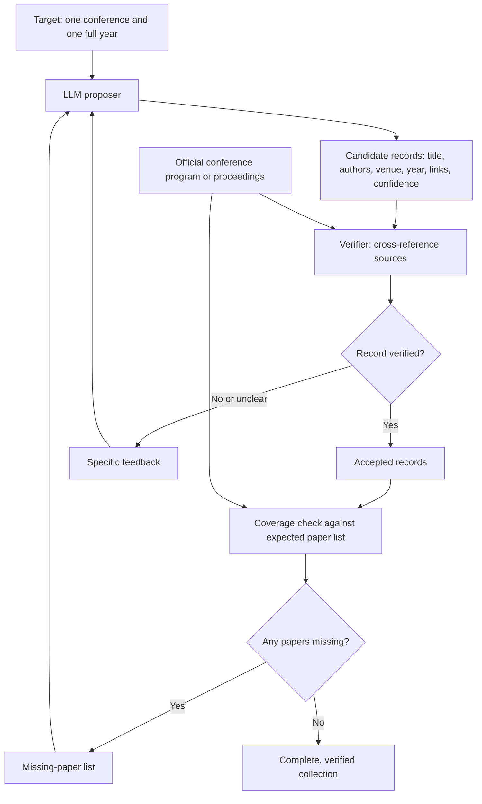

# Meeting 2

## Evaluation: human-checked samples

- Use manually checked papers to evaluate the scraping agent’s output.
- Use one complete year of a selected conference as a bounded collection target.
- Compare the collected papers against the conference’s official paper list.

## Completeness vs. correctness

These measure different things:

| Measure | Question |
|---|---|
| **Completeness** | Did we collect every paper in the target conference year? |
| **Correctness** | Are the collected papers and their metadata accurate? |

**Example:** A conference published 100 papers. The agent collects 80 unique papers, all with the correct metadata and PDFs.

- **Correctness: 100%** — every collected record is correct.
- **Completeness: 80%** — 20 papers are missing.

Checking only the returned papers cannot establish completeness. We also need the expected paper list to identify omissions.

## Data-scraping agent

### 1. LLM proposer

Find candidate papers for the selected conference and year. For each candidate, return:

- Paper title
- Authors
- Conference and year
- Paper page and PDF links
- Confidence estimate

The confidence estimate helps prioritize review; it does not establish correctness.

### 2. Verifier

Cross-reference each candidate against the official conference program or proceedings. Use publisher or author pages as supporting sources where needed.

- **Pass:** Accept the verified record.
- **Fail or unclear:** Return specific feedback to the proposer, such as incorrect year, mismatched authors, or a PDF belonging to a different paper.
- The proposer revises the candidate and submits it for verification again.

### 3. Coverage check

Compare the accepted records against the full conference-year list. Send missing papers back to the proposer for collection.

## Agent workflow

**Suggested safeguard:** Limit retries and send unresolved cases for human review. Keep unresolved and missing records visible rather than treating them as successfully collected.
